# OpenReadout

OpenReadout lets AI agents read and analyze raw files from lab instruments like microscopes, mass specs, flow cytometers, plate readers and NMR. It reads 120+ formats without vendor software, and runs as an MCP server, a CLI, or a Python or R package.

<p align="center">
  <a href="https://github.com/openreadout/openreadout/actions/workflows/ci.yml"></a>
  <a href="https://openreadout.github.io/openreadout/"></a>
  <a href="#license"></a>
</p>

<p align="center">
  <strong>🧪 Try it:</strong> <a href="https://openreadout.github.io/openreadout/demo/">browser demo</a> &nbsp;|&nbsp; <strong>📖 Docs:</strong> <a href="https://openreadout.github.io/openreadout/">openreadout.github.io/openreadout</a>
</p>

https://github.com/user-attachments/assets/7ee0f9fe-e6e0-4378-a46d-5cdc04d57151

<p align="center"><em>An agent finds the cerebellum in a 3.7 GB slide scan and labels its layers. Data: <a href="https://zenodo.org/records/10577621">Zenodo 10577621</a> (CC BY 4.0).</em></p>

<details>
<summary>Another example: checking a gene knockout across five instruments</summary>

https://github.com/user-attachments/assets/658d300b-dc9d-4164-af84-bb48261fd33f

<p align="center"><em>Data: Edyanto et al., <a href="https://doi.org/10.6084/m9.figshare.33265719">figshare</a> (CC BY 4.0).</em></p>

</details>

## Get Started

Install it, then connect it to your agent:

```bash
brew install openreadout/tap/openreadout    # other ways under Installation below
openreadout mcp --install claude-desktop    # or claude, codex, cursor, vscode, gemini
```

Then ask your agent about a file, like "What's in cells.czi?" In Claude Code you can install it as a plugin instead (see [AI Integration](#ai-integration)).

Or try the [browser demo](https://openreadout.github.io/openreadout/demo/) with no install. Your files never leave your computer.

## What It Reads

<p align="center">
  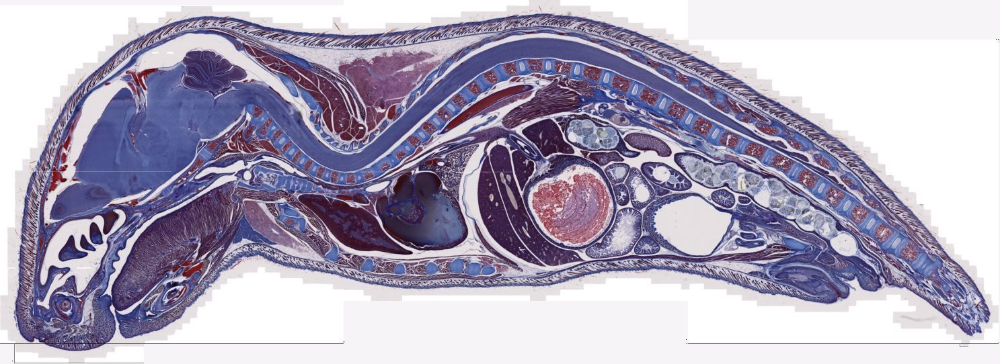
</p>

<p align="center"><em>A whole mouse section from a 3.7 GB Zeiss slide scan.</em></p>

<p align="center">
  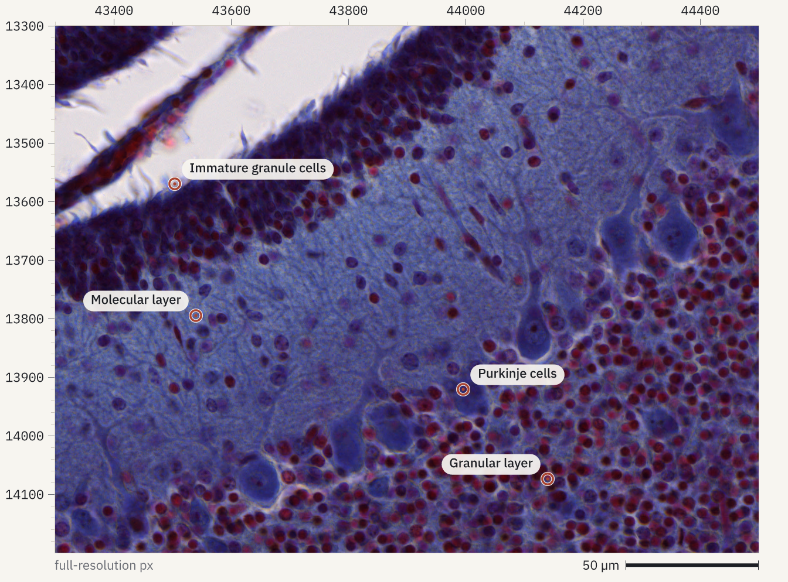
</p>

<p align="center"><em>One fold of the cerebellum, labelled by an agent.</em></p>

<p align="center">—</p>
<p align="center"><strong>Microscopy</strong></p>

<table>
<tr>
<td width="33%">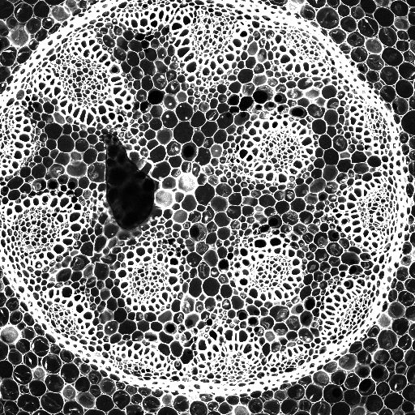</td>
<td width="33%">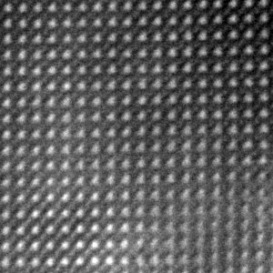</td>
<td width="33%">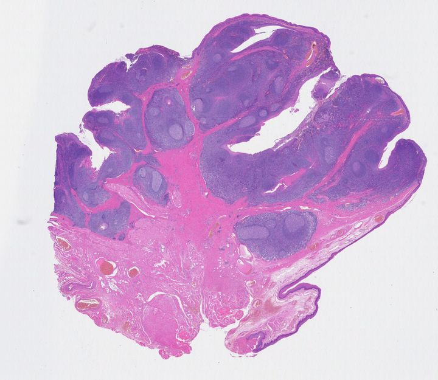</td>
</tr>
<tr>
<td align="center"><sub>Leica LIF · confocal lambda scan</sub></td>
<td align="center"><sub>Gatan DM3 · atomic-resolution STEM</sub></td>
<td align="center"><sub>PerkinElmer QPTIFF · H&amp;E whole slide</sub></td>
</tr>
</table>

<p align="center">—</p>
<p align="center"><strong>Figures</strong></p>

<table>
<tr>
<td width="50%">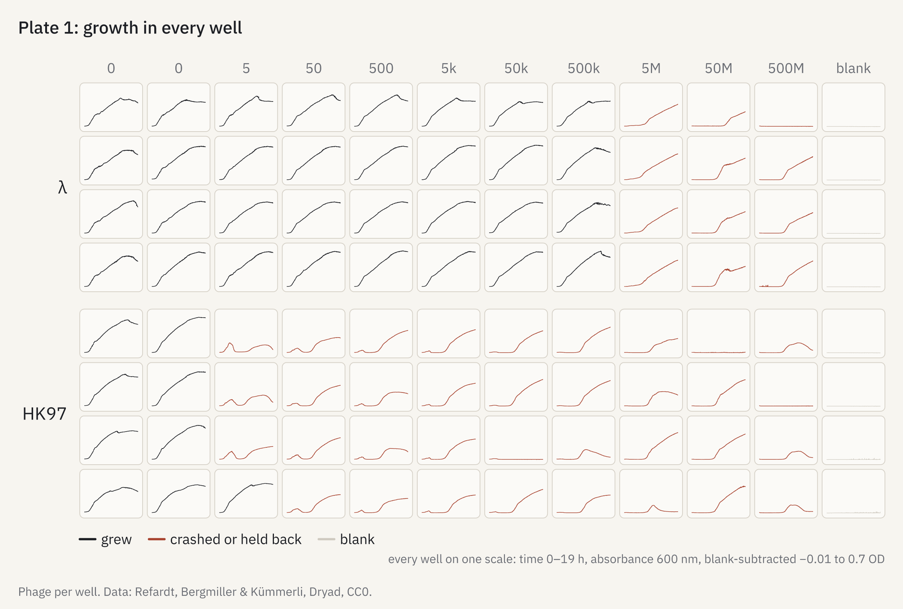</td>
<td width="50%">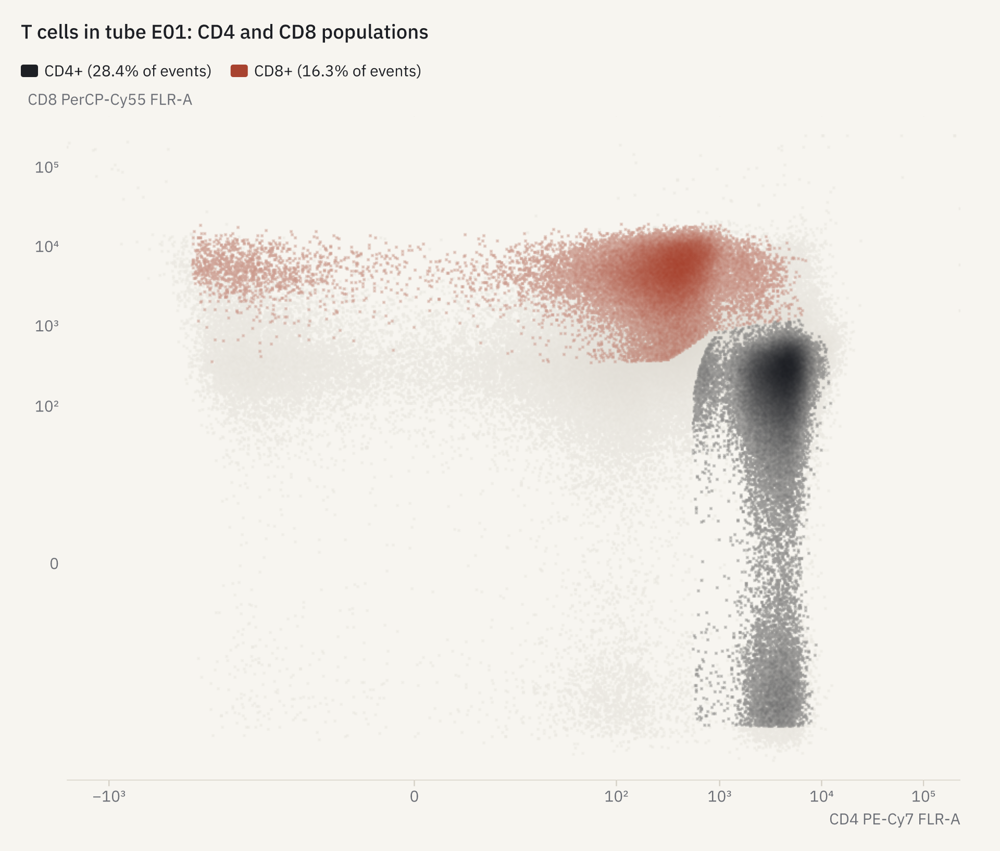</td>
</tr>
<tr>
<td align="center"><sub>SoftMax .pda · 96 growth curves in plate positions</sub></td>
<td align="center"><sub>BD FCS and FlowJo · gated T cells</sub></td>
</tr>
<tr>
<td width="50%">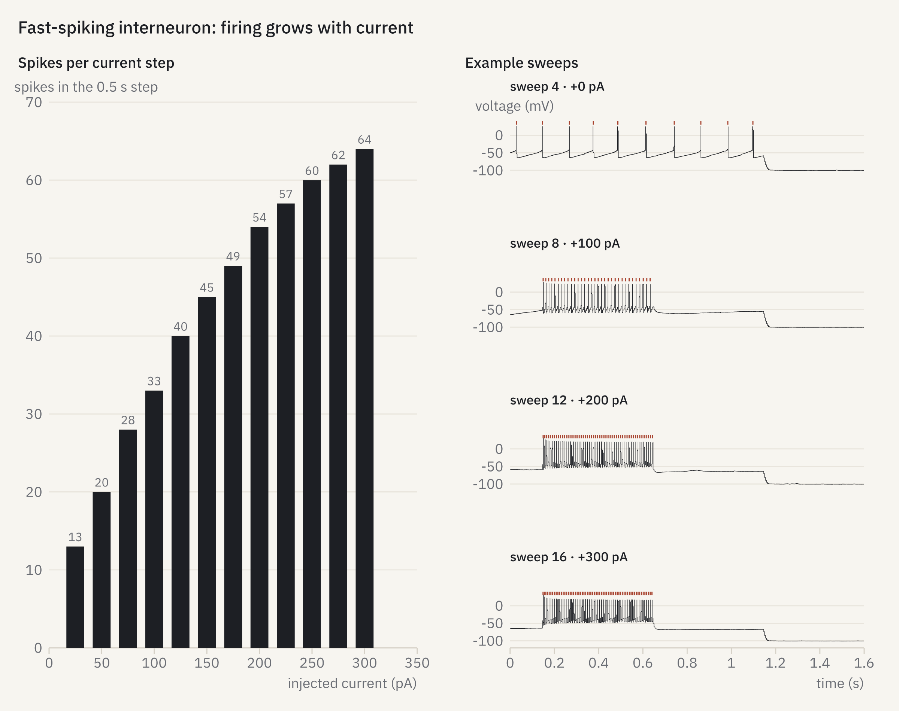</td>
<td width="50%">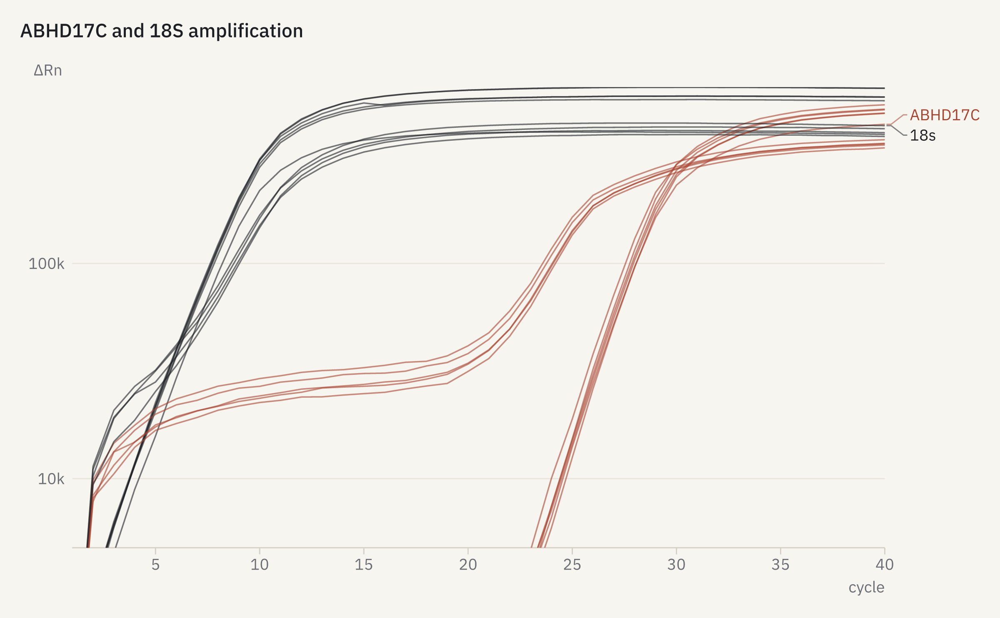</td>
</tr>
<tr>
<td align="center"><sub>Axon ABF · firing against current</sub></td>
<td align="center"><sub>Applied Biosystems .eds · qPCR amplification</sub></td>
</tr>
<tr>
<td width="50%">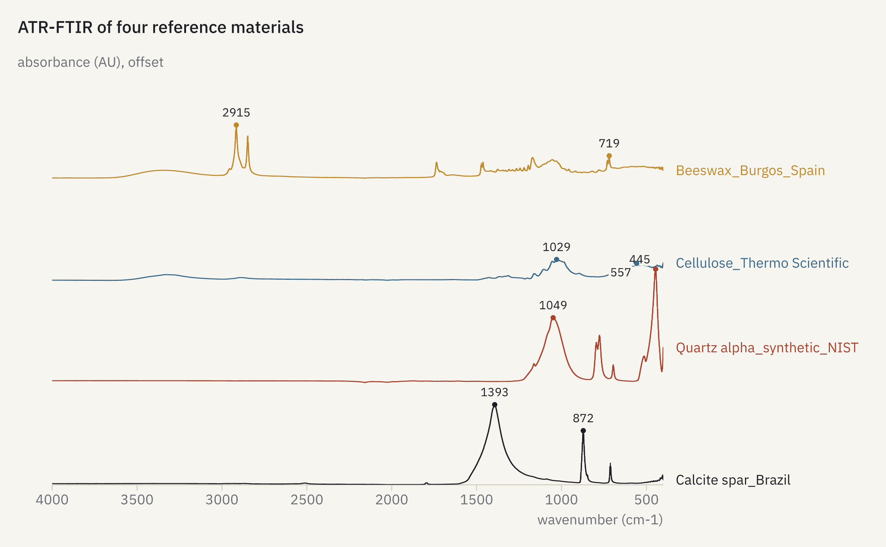</td>
<td width="50%">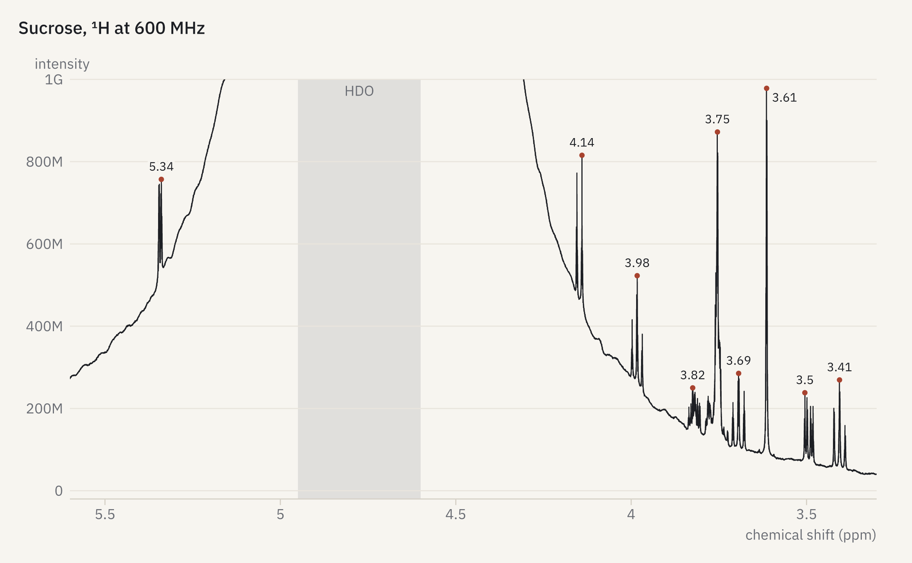</td>
</tr>
<tr>
<td align="center"><sub>Thermo OMNIC .spa · FTIR spectra</sub></td>
<td align="center"><sub>Bruker TopSpin · NMR from the raw FID</sub></td>
</tr>
</table>

<p align="center"><em>All read from the raw files. More in the <a href="https://openreadout.github.io/openreadout/gallery.html">gallery</a>.</em></p>

## What It Does

- **Inspect** images, channels, traces, spectra, tables, and metadata, in plain text or structured JSON
- **Check** files for truncation, missing planes, and damaged structure, with exit code 4 when a file is corrupt
- **Export** to OME-TIFF, OME-Zarr, mzML, NWB, CSV, Parquet, Arrow, JCAMP-DX, Allotrope ASM, and RDML, reading every export back to verify it
- **Preview** image planes, traces, spectra, and plate heat maps as PNG
- **Analyze** chromatographic peaks, plate assays (IC50, standard curves), qPCR (Cq, ΔΔCq), NMR peaks, patch-clamp features, spikes, and flow-cytometry gates, with documented methods
- **Batch** over whole directories, index lab shares, and watch running acquisitions

## On the Command Line

```bash
# Install (macOS / Linux; other ways under Installation)
curl -fsSL https://raw.githubusercontent.com/openreadout/openreadout/main/scripts/install.sh | sh

# What is in the file?
openreadout info cells.lif
# → format: Leica LIF (lif) v2  size: 16.0 MiB  images: 1  planes: 2
# →   [0] PEI_laminin_35k  2048x2048 z=1 c=2 t=1  uint16  px=0.3250 µm
# →       objective: HC PL FLUOTAR L 20x/0.40 DRY

# Is it complete?
openreadout check partial-copy.lif
# → error  truncated       block chain runs past end of file
# → error  missing_planes  geometry needs 16777216 bytes but only 8969789 are stored

# Integrate the peaks of a chromatogram
openreadout analyze peaks gc-run.ch --min-height 1
# → 4 peaks, area in pA·min
# → 1   4.852 min  area 0.2779  25.08 %
# → ...

# Structured JSON for scripts and agents
openreadout info cells.lif --json
```

```json
{
  "ok": true,
  "schema_version": "2",
  "data": {
    "format": { "id": "lif", "name": "Leica LIF", "vendor": "Leica Microsystems" },
    "images": [
      {
        "size_x": 2048, "size_y": 2048, "size_c": 2,
        "pixel_type": "uint16",
        "physical_size": { "x": 0.325, "y": 0.325, "unit": "µm" }
      }
    ]
  }
}
```

<p align="center">
  
</p>

## Formats

| Area | Formats | Export to |
| --- | --- | --- |
| Light microscopy | Zeiss CZI, Nikon ND2, Leica LIF, Olympus OIR/VSI/OIB, Imaris, OME-TIFF and other TIFF variants, OME-Zarr, whole-slide images (including Philips iSyntax, Hamamatsu VMS and MIRAX) | OME-TIFF, OME-Zarr |
| High-content screening | Harmony (Opera Phenix, Operetta), ImageXpress, CellVoyager | OME-Zarr plate, OME-TIFF |
| Electron microscopy | MRC, Gatan DM3/DM4, FEI SER/EMI, Velox EMD, EER movies, SerialEM mdoc | OME-TIFF, OME-Zarr, MRC |
| Structural biology | CBF/miniCBF, SMV, EIGER NeXus (NXmx) diffraction images | MRC, OME-TIFF |
| Medical imaging | DICOM (files, series, studies, DICOMDIR), NIfTI, Analyze, Bruker ParaVision | NIfTI, OME-TIFF |
| Mass spectrometry | Thermo RAW, Bruker timsTOF and BAF, Agilent MassHunter, Waters MassLynx, Sciex WIFF, mzML | mzML, Parquet, Arrow |
| Chromatography | Agilent ChemStation and OpenLab, Shimadzu, Chromeleon, AIA/ANDI | CSV, JCAMP-DX, Parquet |
| Electrophysiology | Axon ABF, Intan, SpikeGLX, Open Ephys, Neuralynx, Blackrock, Plexon, HEKA, Spike2, TDT, Axona, NWB | NWB, CSV, Parquet |
| NMR and spectroscopy | Bruker TopSpin and OPUS, Varian, JEOL, Thermo OMNIC, Renishaw, JCAMP-DX, SPC | JCAMP-DX, CSV |
| Flow cytometry | FCS, FlowJo workspaces, Gating-ML | CSV, Parquet, Arrow |
| Plate readers and qPCR | Plate-reader exports, RDML, Applied Biosystems, LightCycler, Rotor-Gene | Allotrope ASM, RDML, CSV |
| DNA sequencing and electrophoresis | Illumina run folders, Oxford Nanopore POD5 and FAST5, FASTQ, BAM, ABIF Sanger and fragment-analysis files, Agilent Bioanalyzer and TapeStation | FASTQ, CSV, Parquet |
| Other | NanoDrop, Qubit, Incucyte, gel and blot imagers, ÄKTA, ITC, Biacore, Seahorse, Octet, Zetasizer, XRD, EPR, electrochemistry, thermal analysis | CSV, Parquet |

The [format list](https://openreadout.github.io/openreadout/formats.html) lists every format OpenReadout reads, with its known gaps.

## Installation

Ships as a single self-contained binary. No Java, no Python, no vendor DLLs -- nothing else to install.

```bash
# macOS / Linux
curl -fsSL https://raw.githubusercontent.com/openreadout/openreadout/main/scripts/install.sh | sh

# Windows (PowerShell)
irm https://raw.githubusercontent.com/openreadout/openreadout/main/scripts/install.ps1 | iex

# Homebrew (macOS / Linux)
brew install openreadout/tap/openreadout

# npm (all platforms; installs the native binary for your platform as a dependency)
npm install -g openreadout

# Rust toolchain
cargo install openreadout --locked
```

Docker, Nix, cargo-binstall, and the other channels are on the [install page](https://openreadout.github.io/openreadout/getting-started/install.html).

Verify installation: `openreadout --version`

## AI Integration

### MCP Server

Built-in [MCP](https://modelcontextprotocol.io) server — register with one command:

```bash
openreadout mcp --install claude          # Claude Code
openreadout mcp --install claude-desktop  # Claude Desktop
openreadout mcp --install codex           # OpenAI Codex
openreadout mcp --install cursor          # Cursor
openreadout mcp --install vscode          # VS Code / Copilot
openreadout mcp --install gemini          # Gemini CLI
```

Windsurf, Zed, Continue, and Cline are supported too. The server exposes 28 tools (`openreadout_info`, `openreadout_check`, `openreadout_preview`, `openreadout_export`, `openreadout_peaks`, ...) over JSON-RPC, so the client doesn't need shell access.

### Claude Code Plugin

Installs the MCP server and the skill together:

```text
/plugin marketplace add openreadout/agent-plugins
/plugin install openreadout@openreadout
```

### Gemini CLI Extension

```bash
gemini extensions install https://github.com/openreadout/agent-plugins
```

### Codex Plugin

```bash
codex plugin marketplace add openreadout/agent-plugins
codex plugin add openreadout@openreadout
```

Each of these adds the skill and the MCP server from the [openreadout/agent-plugins](https://github.com/openreadout/agent-plugins) repository. The server runs the `openreadout` binary from your `PATH`, so [install](#installation) it first.

### Agent Skill

```bash
openreadout self skill --install claude   # ~/.claude/skills/openreadout
openreadout self skill --install agents   # ~/.agents/skills/openreadout (Codex, Cursor, Copilot, Gemini CLI)
```

The skill source is in [`skills/openreadout`](skills/openreadout).

### Built for Agents

- **JSON output** for every command, with [published schemas](docs/schema).
- **Fixed exit codes:** `0` ok, `1` error, `2` usage, `3` unknown format, `4` corrupt, `5` I/O, `6` unsupported.
- **Errors with a hint** about what to try next.
- **Assurance on every result:** whether that kind of file was checked against another reader. `--strict` refuses anything that wasn't.
- **Previews** the agent can look at, as PNG.
- **Figures** from `plot`: plate grids, dose-response fits, gated dot plots and more, as PNG, SVG or PDF.
- **Fast metadata:** `info` reads headers only, so a 100 GB file is as quick as a small one.
- **Read-only and offline.**

## Python and R

**Python** — `pip install openreadout` returns metadata as dicts and pixels as NumPy, dask, or xarray arrays, with plugins for [bioio](https://github.com/bioio-devs/bioio) and napari. See the [Python guide](https://openreadout.github.io/openreadout/guides/python.html).

```python
import openreadout

with openreadout.File("cells.lif") as f:
    f.images[0]["channels"]     # same keys as `info --json`
    stack = f.to_xarray(0)      # labelled with channel names and µm
    f.preview(composite=True)   # shows itself in Jupyter

openreadout.plot(data={"file": "growth.pda"}, facet="plate").save("plate.pdf")
```

**R** — the R package returns arrays and data frames, and draws the same previews and figures. See the [R guide](https://openreadout.github.io/openreadout/guides/r.html).

## Comparison

| | OpenReadout | Bio-Formats | bioio | czifile / nd2 / liffile | msconvert |
|---|---|---|---|---|---|
| Open source & free | ✓ (MIT / Apache-2.0) | ✓ (GPL) | ✓ (plugins vary) | ✓ (BSD) | ✓ (vendor DLLs are not) |
| AI-native CLI + JSON + MCP | ✓ | ✗ | ✗ | ✗ | ✗ |
| Zero install (single binary) | ✓ | ✗ (JVM) | ✗ (Python) | ✗ (Python) | ✗ |
| No vendor DLLs | ✓ | ✓ | ✓ | ✓ | ✗ |
| Integrity check | ✓ | ✗ | ✗ | ✗ | ✗ |
| Microscopy | ✓ | ✓ | ✓ | ✓ (one format each) | ✗ |
| Mass spectrometry | ✓ | ✗ | ✗ | ✗ | ✓ |
| Ephys, flow, NMR, chromatography, plates, qPCR | ✓ | ✗ | ✗ | ✗ | ✗ |
| Cross-platform | ✓ | ✓ | ✓ | ✓ | Windows (or Wine) |

## Validation

Each reader is tested against other readers on public instrument files. See [how we validate](https://openreadout.github.io/openreadout/project/how-we-validate.html).

The readers were written from public files, published specifications and permissively licensed readers (credited in [NOTICE](NOTICE)), without vendor SDKs or DLLs. GPL readers such as Bio-Formats are only run as black boxes in tests. See the [clean-room policy](docs/legal/clean-room-policy.md) and the per-format [provenance logs](docs/provenance).

## Documentation

The [documentation](https://openreadout.github.io/openreadout/) has guides for every command and format:

- **Getting started:** [Install](https://openreadout.github.io/openreadout/getting-started/install.html) | [Your first file](https://openreadout.github.io/openreadout/getting-started/first-file.html) | [Reading the JSON output](https://openreadout.github.io/openreadout/getting-started/reading-json.html)
- **Reference:** [Commands](https://openreadout.github.io/openreadout/reference/commands.html) | [MCP tools](https://openreadout.github.io/openreadout/reference/mcp.html) | [Formats](https://openreadout.github.io/openreadout/formats.html)
- **Gallery:** [previews and figures drawn from public files](https://openreadout.github.io/openreadout/gallery.html)
- **Guides:** [AI agents](https://openreadout.github.io/openreadout/guides/agents.html) | [Python](https://openreadout.github.io/openreadout/guides/python.html) | [R](https://openreadout.github.io/openreadout/guides/r.html) | [Recipes](https://openreadout.github.io/openreadout/recipes.html) | [Batch tables](https://openreadout.github.io/openreadout/guides/batch.html)
- **A file that does not work:** run `openreadout report FILE` and attach the bundle to a [new-variant issue](https://github.com/openreadout/openreadout/issues/new?template=new-variant.yml). The bundle contains no data values, sample names, or paths.

## Privacy

OpenReadout runs on your computer, makes no network connections and sends no telemetry. See [PRIVACY.md](PRIVACY.md).

## License

Licensed under either the [Apache License 2.0](LICENSE-APACHE) or the [MIT license](LICENSE-MIT), at your option. OpenReadout is not affiliated with any instrument vendor; see [TRADEMARKS.md](TRADEMARKS.md).

Bug reports and contributions are welcome on [GitHub Issues](https://github.com/openreadout/openreadout/issues). See [CONTRIBUTING.md](CONTRIBUTING.md), and read the [clean-room policy](docs/legal/clean-room-policy.md) before working on a reader.

Images and demo files come from the public test corpus ([`corpus/manifest.toml`](corpus/manifest.toml)), used under their licences: mouse section, Zeiss sample images for Bio-Formats ([Zenodo 10577621](https://zenodo.org/records/10577621), CC-BY-4.0); Convallaria lambda scan, Maria Manuela Azevedo ([Zenodo 14976703](https://zenodo.org/records/14976703), CC-BY-4.0); BaTiO3 STEM, Rama Vasudevan and Gerd Duscher ([Zenodo 8190744](https://zenodo.org/records/8190744), CC-BY-4.0); H&E QPTIFF, PerkinElmer via the OME sample images (CC-BY-4.0); terminal demo, Allen Institute for Cell Science (BSD-3-Clause); knockout chat, Edyanto et al. ([figshare](https://doi.org/10.6084/m9.figshare.33265719), CC-BY-4.0). The figures come from the docs gallery, which lists each source file. [`demo.tape`](.github/assets/demo.tape) regenerates the demo.

---

If you find OpenReadout useful, please [give it a star on GitHub](https://github.com/openreadout/openreadout) — it helps others discover the project.
